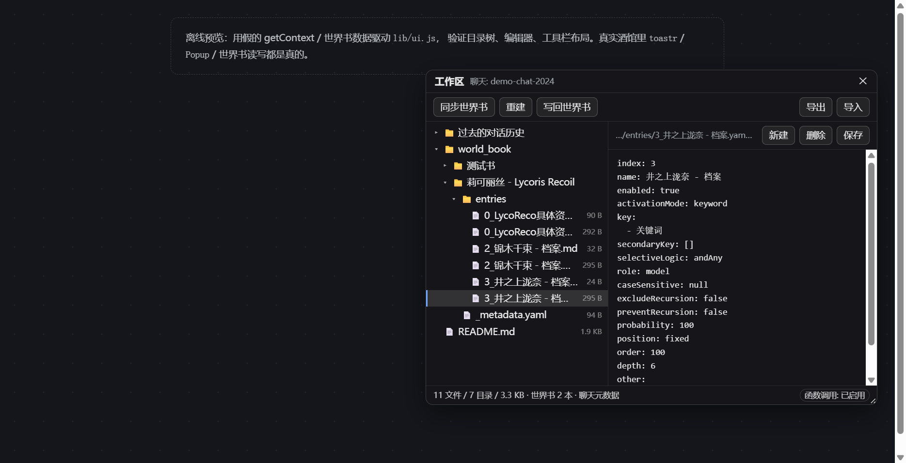
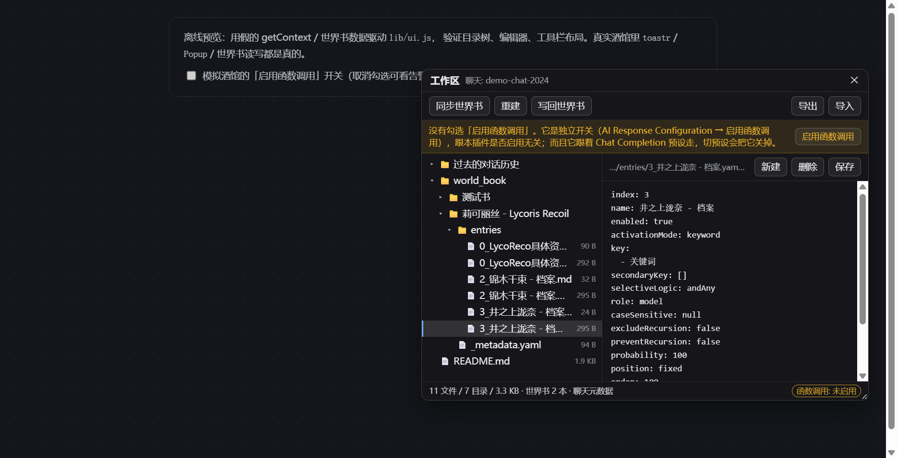

# Atelier

给 **SillyTavern 每个聊天**配一块前端工作区：世界书按条目落成 `md` + `yaml` 文件，
模型通过 `read` / `write` / `edit` 三个函数工具直接读写这些文件，改完一键写回世界书。

> 适配版本：SillyTavern **1.18.0**（当前实测）/ 1.19.0，都用酒馆自带的能力，没有额外依赖



---

## 一、它解决什么问题

酒馆里的世界书是"一堆 JSON 字段 + 一大坨正文"，模型没法精确地只看某一条、改某一段。
这个插件把当前聊天启用的每本世界书摊成一个目录：

```
/world_book/莉可丽丝 - Lycoris Recoil/
    _metadata.yaml
    entries/
        0_LycoReco具体资料.yaml     ← 结构化字段
        0_LycoReco具体资料.md       ← 条目正文（content）
        3_井之上泷奈 - 档案.yaml
        3_井之上泷奈 - 档案.md
        ...
```

模型可以直接 `read` 某条的 `.md`、用 `edit` 改一句话、用 `write` 新建一条，
再点一次「写回世界书」就回到酒馆里。比让模型重写整本世界书省 token，也不容易改坏别的条目。

---

## 二、安装

扩展目录（二选一）：

| 位置 | 说明 |
|---|---|
| `data/<用户>/extensions/atelier/` | 推荐，扩展装在这里 |
| `public/scripts/extensions/third-party/atelier/` | 全局兜底，酒馆启动时会自动搬到用户目录 |

方式 A：用安装脚本（Windows）

```powershell
pwsh -File .\install.ps1
# 或指定目标： .\install.ps1 -Target "D:\SillyTavern\data\default\extensions"
```

方式 B：手动把整个文件夹复制过去，然后在酒馆「扩展」面板里确认 **Atelier** 已启用，刷新页面。

启用后，魔杖菜单（🪄）里会多一行 **Atelier**；也可以在聊天输入框里执行 `/atelier` 打开（`/workspace`、`/ws` 仍可用）。

---

## 三、界面

一个可拖动、可缩放的浮动面板：

```
┌ 工作区                              聊天: xxx  ✕ ┐
│ [同步世界书] [重建] [写回世界书]      [导出] [导入] │
├──────────────┬───────────────────────────────────┤
│ 📁 chat_history │ 路径 / 未保存        [新建][删除][保存] │
│ 📁 world_book  │                                   │
│   📁 莉可丽丝   │   （文本编辑器）                    │
│     📄 _metadata.yaml                               │
│     📁 entries                                     │
│       📄 0_xxx.yaml                                │
│       📄 0_xxx.md                                  │
├──────────────┴───────────────────────────────────┤
│ 12 文件 / 8 目录 / 34.2 KB · 世界书 1 本 · IndexedDB │
└──────────────────────────────────────────────────┘
```

| 按钮 | 作用 |
|---|---|
| 同步世界书 | 把当前聊天启用的世界书导入成文件；**只补缺失**，不覆盖你已经改过的文件 |
| 重建 | 删掉 `world_book/` 重新导入（会丢手改内容，有二次确认） |
| 写回世界书 | 把文件写回酒馆世界书：按 `index`(=uid) 覆盖已有条目，不删除"文件里没有的条目" |
| 导出 / 导入 | 选中文件或文件夹 → 打成 **ZIP** 下载（不选就整包导出）；导入支持 ZIP 和散装文件 |
| 新建 / 重命名 / 移动 / 删除 / 保存 | 文件操作；**文件夹也能点选**，「重命名」改路径、「移动」只换目录（文件名不变），删除会整个目录移除；`Ctrl/Cmd + S` 也能保存 |

底部会显示 **函数调用: 已启用 / 未启用**。未启用时模型根本收不到 `read/write/edit`。

**插件启用时会自动打开两个开关**（不用手动去预设面板点）：

| 设置 | UI 元素 | 值 |
|---|---|---|
| 启用函数调用 | `#openai_function_calling` | 勾选 |
| Interleaved Thinking → Active Tool Chain | `#tool_reasoning_mode` | `active_chain` |

实现是模拟用户操作（设值 + 派发 `input` / `change`），让酒馆自己的处理器去写 `oai_settings`；
元素还没渲染时会直接改内存里的 `chatCompletionSettings` 兜底。

两个注意点：

- **Active Tool Chain 只在「显示思考过程」（`show_thoughts`）打开时生效** —— 这是酒馆自己的门控
  （`setToolReasoningControls()`），插件不去动它；
- 切预设可能把这些值重置，插件只在**加载/启用时**设一次，不会一直盯着改。

想关掉这个自动行为：`extension_settings.atelier.autoTooling = false`。

### 自动同步（默认开）

工具栏里有个 **自动同步** 勾选框：

- **打开 / 切换聊天**时，把当前启用的世界书自动补进 `world_book/`；
- 世界书内容变了（`WORLDINFO_UPDATED`）、或启用的书换了（`WORLDINFO_SETTINGS_UPDATED`）时也会补；
- **停用一本世界书**时，它的目录会一起从工作区移除（这是"同步"的另一半），
  toast 里会列出被移除的书名；重新启用会再自动导入；
- **工作区里改了世界书文件**（`read/write/edit` 工具、`js`、面板保存）→ 防抖 800ms
  自动 `saveWorldInfo` 写回酒馆，不用再点「写回世界书」；
- 只补缺失文件（fill 模式），**不覆盖**工作区里已有的条目 —— 不会冲掉模型或你手改过的内容；
- 写回按 `index`(=uid) 合并，**不删**酒馆里有、文件里没有的条目（和手动写回一致）；
- 同一批书 + 同一次世界书版本只跑一次（有签名去重），切聊天会重置；
- 世界书列表还没加载好（拿到空列表）时**不动手**，避免启动早期把工作区删空；
- 关掉就退回纯手动：既不再自动导入，也不再自动写回。

### 导出 / 导入（ZIP）

**导出**：先点选一个文件或文件夹（文件夹也能选），再点「导出」——

- 选文件 → 打成一个只含该文件的 ZIP；
- 选文件夹 → 整个目录树打进去（保留工作区内的相对路径）；
- 什么都没选 → 整个工作区打成一个 ZIP。

ZIP 里路径是工作区相对路径（`world_book/甲/entries/0_a.md`），
所以再导入能原位还原。整包/目录导出时还会带一个 `__workspace_meta.json`，
记着「目录名 → 世界书名」的映射（书名有非法字符时目录名会被改写，靠它还原）。

**导入**：点「导入」，可以选 ZIP，也可以选散装文件（多选）：

- ZIP → 按里面的路径还原（带 `..` 的条目会被丢弃，二进制文件跳过）；
- 散装文件 → 放进**当前选中的目录**（选中的是文件则用它的父目录，没选就丢根目录）；
- 覆盖前会弹确认，并告诉你多少个文件会被覆盖。

> 实现用的是酒馆自带的 `public/lib/jszip.min.js`（酒馆自己的 `utils.js` 也是这么加载的），
> 没有额外依赖；下载走 `Blob` + `<a download>`，不经过服务器。

设置存在 `extension_settings['atelier'].autoSync`，默认 `true`。

### 上下文压缩

入口：工具栏「功能」抽屉里的 **上下文压缩** 开关 + **立即压缩** 按钮。

**默认关闭。** 不勾选时不会自动压缩，也不会在生成结束后偷偷跑摘要；
「立即压缩」是手动操作，任何时候都能用。

抽屉里可调两个参数：

| 参数 | 默认 | 范围 | 含义 |
|---|---|---|---|
| 阈值 | `0.5` | 0.1–0.95 | 聊天 token 占上下文窗口的比例，超过就压 |
| 保留尾部 | `6` | 2–40 | 最近多少条消息原样保留，不参与压缩 |

两个值都会写进 `extension_settings['atelier']`（`compressionThreshold` / `compressionKeepLast`），
刷新后还在。

**触发**：勾选后，生成结束时估算聊天 token，超过 `窗口 × 阈值` 就压一次。
估算用酒馆自己的 tokenizer（`getTokenCountAsync`），拿不到就按字符 ×0.6 退化成粗估。

**压缩时**（不打断回复，在生成结束后跑）：

1. 把要压的那段原文按楼层写进 `/chat_history/<楼层>-<分支>.md`（一条消息一份）；
2. 用当前模型静默生成摘要（`generateQuietPrompt`，六段模板：当前情境 / 已发生事件 / 角色状态 /
   设定与伏笔 / 用户偏好 / 接续点）；
3. 状态存进 `chat_metadata.atelier_compression`：摘要、范围、**每条消息的指纹**、归档路径。

**请求发出前**（`CHAT_COMPLETION_PROMPT_READY`，只在 `dryRun=false` 时动手）：

- 用指纹在请求数组里定位那几条消息，`system` 消息一条都不碰；
- 替换成一条摘要消息，内容带指针：`完整原文在 /chat_history/2-1.md ~ /chat_history/14-1.md，需要细节就用 read 读它`；
- **指纹对不上就整体跳过** —— 你把那几条消息编辑过、删过，这次就不压，宁可多花 token 也不能换错。

**聊天里会留一个折叠块**：压缩完在边界处插入一条 system 消息，渲染成虚线框：

`
🗜️ 上下文压缩：13 条已摘要 · 原文 /chat_history/2-1.md ~ /chat_history/14-1.md
▶ 展开摘要
`

点开就是完整摘要（## 小标题 会渲染成粗体）。这条消息跟普通楼层一样可以删，
删掉不影响已经存下的摘要状态 —— 下次压缩会重新算。

和 hermes 的区别：**不改聊天文件**。聊天记录原样保留，改的只是发给模型的数组；
关掉插件或删掉 `chat_metadata` 里那个键，立刻恢复原样。

| 参数 | 位置 | 默认 |
|---|---|---|
| 触发阈值 | `ChatCompression.threshold` | `0.5` |
| 尾部保留条数 | `ChatCompression.keepLast` | `6` |
| 总开关 | `extension_settings['atelier'].compression` | `true` |

局限：

- 摘要要额外调一次模型，长对话第一次压缩会明显慢一点（1–3 秒，发生在生成结束之后，不影响回复）；
- 带 `tool_calls` 的消息可能和请求里的形态对不上，对不上就跳过 —— 压缩是尽力而为，不是保证；
- 只压"首条 + 尾部"之外的那段，首条（通常是开场白）和最近 6 条永远原样保留。

### 自我改进回顾

按钮：工具栏里的 **回顾**（`data-action="review"`）。

hermes 的自我改进有三条路子，我们各借了一点：

| hermes | 源码位置 | 我们的做法 |
|---|---|---|
| **提示词常驻注入**（`SKILLS_GUIDANCE` / `build_memory_guidance`），主 Agent 干活时自己就写记忆 | `agent/prompt_builder.py` | `setExtensionPrompt` 往主提示词里塞一句"可以直接写 `/记忆/`" |
| **主会话自己写过就清零**：调过 `skill_manage` 就把 `_iters_since_skill` 置 0 | `agent/tool_executor.py:747` | 工具写进 `/记忆/` 时，两个计数器一起归零 |
| **后台 Fork 审查**：`_iters_since_skill ≥ 10` 或 `_turns_since_memory ≥ 10` 就起 `bg-review` 线程 | `agent/turn_finalizer.py:764`、`turn_iteration_prep.py:167` | 同样的双计数器，但不开线程，跑 `generateQuietPrompt` |
| 闲置管家 curator（2 小时闲置 + 7 天间隔） | `agent/curator.py` | **不做** —— 用户明确不要定时/闲置触发 |

所以我们的触发条件是 **`turns ≥ 10` 或 `iters ≥ 10`**（都不是时间），外加手动按钮。
计数器存在 `chat_metadata.atelier_review`，跑一次两个都清零。

**两个计数器的口径必须和 hermes 一致，否则会被酒馆的递归骗到：**

| | 计什么 | 实现 |
|---|---|---|
| `turns` | **用户轮**：用户每发一条消息 +1 | 不能挂 `GENERATION_ENDED` —— 遇到 tool_calls 时 ST 会 `Generate(depth + 1)` 重入（`script.js:5377`），每轮工具都会触发一次该事件。改用 `chat` 里 `is_user` 消息条数的增量 |
| `iters` | **工具轮**：一轮工具调用 +1，**同一轮里几个并行调用仍算 1** | 挂 `TOOL_CALLS_PERFORMED`（`tool-calling.js:905`，一轮只发一次，带这一轮的全部 invocations）。老版本没有这个事件时，退化成按每次工具调用计数 |

**区别在于没有 fork。** hermes 的 fork 复用主会话 system prompt / tools[] 做到字节级一致，白嫖前缀缓存；
我们拿不到那个位置，所以退一步：`generateQuietPrompt` 只问一次、只收 JSON，写入由代码做。

**输出协议**（模型唯一能做的事）：

```json
{"save":[{"file":"user-pref","text":"新的写法","replaces":"要替换掉的旧那条（可省略）"}]}
```

`replaces` 是 hermes "fix in place, don't append UPDATE" 的对应物：命中旧条目就原地改写，行数不变。

**四个分类**（模型能返回的 `file` 值）：

| file | 文件 | 装什么 |
|---|---|---|
| `user-pref` | `/记忆/用户偏好.md` | 称呼、语气、写作风格、明确说过的禁忌 |
| `world` | `/记忆/世界设定.md` | 已确立的设定事实：地名、组织、关系、能力、约定 |
| `style` | `/记忆/文风.md` | 用户认可过或要求过的写法特征 |
| `todo` | `/记忆/待确认.md` | 拿不准、需要用户确认的观察 |

**只能写 `/记忆`，永远不碰 `/world_book`** —— 世界书开着自动写回，让猜测性的回顾去改世界书太危险；
分类白名单硬编码在代码里，模型返回非法 `file` 直接丢弃。

去重是机械的：写之前读原文件，同一条（忽略标点空白）就不写；每条最多 160 字、一次最多 3 条。
有新增就往 `/记忆/回顾记录.md` 记一行。

**原文归档**：回顾窗口里的消息会按 `<楼层>-<分支>.md` 存进 `/chat_history/`（楼层从 1 开始，分支是 swipe+1）：

```
/chat_history/12-1.md      ← 第 12 条消息，第 1 个分支
/chat_history/13-2.md      ← 第 13 条消息切到第 2 个分支
```

工具消息也存，正文是调用参数 + 返回结果（JSON）。压缩摘要和回顾提示本身不归档。
同样的内容第二次回顾不会重写（`Unchanged`），所以窗口重叠也没关系。

提示词里抄了 hermes 的几条硬规则（`_DO_NOT_CAPTURE_BLOCK`）：

- 只写以后用得上的，不写一次性剧情推进；
- 一条一件事，不写"用户说……"这种转述；
- 不写环境临时故障（"某工具坏了"）、不写没验证的猜测；
- 没有就返回 `{"save": []}` —— 允许"这次没东西可写"，不逼着它硬凑。

| 参数 | 位置 | 默认 |
|---|---|---|
| 回合阈值 | `SelfReview.interval` | 10 |
| 工具调用阈值 | `SelfReview.toolInterval` | 10 |
| 每次回看多少条消息 | `SelfReview.keepMessages` | 12 |
| 提示词注入开关 | `SelfReview.useGuidance` | `true` |
| 总开关 | `extension_settings['atelier'].review` | `true` |

### MCP 服务

魔杖菜单（🪄）里多了一行 **MCP 服务**，点开是一个独立面板。

**传输只做网络这一类**（浏览器起不了本地进程，stdio 直接排除）：

| 传输 | 状态 | 说明 |
|---|---|---|
| Streamable HTTP（2025-03-26+） | 默认 | 单端点 POST JSON-RPC；响应可能是 `application/json`，也可能是 `text/event-stream`；会话靠 `Mcp-Session-Id` 头 |
| HTTP + SSE（2024-11-05） | 可选 | 老协议：`GET /sse` 建长连接，首帧 `event: endpoint` 给出 `POST /messages` 地址 |

> Streamable HTTP 里的 "SSE" 只是**同一个请求的流式响应形态**（`application/json` 或 `text/event-stream`），
> 和旧版那套 `GET /sse` + `POST /messages` 的双端点协议不是一回事。
> 面板上**显式二选一**，不做自动探测：选错了直接报错，并提示换成另一种传输再试。
> 网络层失败（`Failed to fetch`）跟传输方式无关——那是 CORS 或地址不通。

**用法**：点右上角「添加」→ 在弹窗里填配置 → 保存，会立刻连接并把工具列出来。
服务器列表存在 `extension_settings['atelier'].mcpServers`。

主面板只做列表和开关，配置都在独立弹窗里：

```
主面板                              配置弹窗（添加 / 编辑）
┌ MCP 服务             [添加] ✕ ┐   ┌ 服务器配置              ✕ ┐
│ 本地测试      已连接 · 2 个工具 │   │ 名称  [本地测试        ]   │
│ Streamable HTTP · … · 1 个请求头│   │ 地址  [https://…/mcp   ]   │
│              [断开][编辑][删除] │   │ 传输  [Streamable HTTP ▾]  │
│                                │   │ 自定义请求头      [加一行] │
│ 老服务      失败：HTTP 405      │   │  [X-Demo ][hello    ] [✕]  │
│ SSE（旧版）· …  [连接][编辑][删除]│  │                    [取消][保存]│
│ [全部连接] [全部断开]           │   └───────────────────────────┘
└────────────────────────────────┘
```

**自定义请求头**：键值对，逐个加到每个请求上（`Authorization`、`X-API-Key` 这类）。
非法 header 名会在保存时被过滤掉（浏览器的 `Headers` 会直接抛 TypeError）；
自定义头放在最后，允许覆盖默认的 `Accept` / `Content-Type`。

**工具桥**：每个 MCP tool 注册成酒馆函数工具，模型可以直接调。

```
名字      mcp_<服务器>_<工具>      （小写、下划线、≤60 字符；重名自动加 _2）
描述      tool.description，截断 900 字符
参数      tool.inputSchema 直接转成酒馆的 JSON Schema
返回值    content[].text 拼起来；图片等非文本块给 [image ...] 占位
```

服务器名是纯中文时清洗后为空，会用一个稳定短哈希兜底（`mcp_s1emdv_echo`），
避免所有中文服务器都退化成同一个前缀。

生命周期：连上注册、断开注销、`shouldRegister: () => client.connected` 再兜一层——
没连上时这些工具根本不会发给模型。

**已知限制**：

- 浏览器直连要求对方放行 CORS，否则一律 `Failed to fetch`；
- 只处理文本结果，二进制/图片给占位符；
- 不会在插件加载时自动连，需要点「全部连接」（避免每次开页面都往外发请求）；
- 工具名做了小写化，`readFile` 和 `read_file` 会撞名，靠后缀区分。

### 工具链自动折叠

一次回答里如果模型连续调了几次工具，聊天里会留下一串中间消息：

```
[你] 演示一下
[AI] 我先看看工作区里有什么。          ← 中间
[系统] Tool calls: Read workspace file   ← 中间
[AI] 再读一个目录。                    ← 中间
[系统] Tool calls: Read workspace file   ← 中间
[AI] 读完了，工作区里只有两本空目录。    ← 最终回答
```

最终回答出来后，插件会把中间那些消息折叠掉，只在回答上方留一个胶囊：

```
[AI] ▸ 已折叠 4 条中间消息 · 2 次工具调用
     读完了，工作区里只有两本空目录。
```

- 点胶囊展开，再点收起；展开状态按"链"记，新消息不会把它重置；
- 历史里每一条已完成的工具链都会各自折叠，不是只折叠最新的一条；
- 切聊天 / 删消息 / 重绘后自动重新计算（`MutationObserver` + ST 的事件）；
- 生成过程中不折叠，等这一轮结束；
- 纯前端行为：只加 CSS 类和按钮，**不改 chat 数组、不影响提示词、不影响存档**。

---

## 四、存储：为什么是 IndexedDB

| | chat_metadata | IndexedDB |
|---|---|---|
| 位置 | 聊天 `.jsonl` 里 | 浏览器本地库 |
| 写入成本 | **每条消息都重写整个 chat 文件** | 只写一条记录 |
| 随聊天导出 / 同步 | 跟着走 | 不跟 |

一本 150 条的世界书 ≈ 几百 KB，如果塞进 `chat_metadata`，聊得越久每次保存越慢。
所以：

- `chat_metadata.atelier = { v, sid, owner, books }` —— 只有指针（几十字节）；
- IndexedDB `SillyTavern / atelier / vfs:<sid>` —— 文件正文。

### 分支 / 改名怎么处理

指针里记了 `owner = 创建它的 chatId`：

- **复制聊天分支**：chat_metadata 被整份复制，`owner` 和当前 chatId 不一致 → 自动克隆一份新 `sid`。
  于是分支**继承内容**，但两边后续改动互不影响。
- **聊天改名**：同理，会得到一份新副本（不会丢，也不会串）。
- 想彻底重来：删掉 `world_book/` 或换聊天即可；IndexedDB 里的孤儿记录不影响使用。

IndexedDB 打不开（隐私模式、浏览器禁用、测试环境）时，插件自动退化：
正文直接写回 `chat_metadata`，功能不变，只是存档会变大。底部状态栏会显示当前用的是哪种。

---

## 五、工具（函数调用）

四个工具，路径都是工作区内的绝对路径，和真实磁盘无关：

### `read`

```json
{ "path": "/world_book/莉可丽丝/entries/0_xxx.md", "startLine": 1, "endLine": 80 }
```

- 文件 → 返回原文（超过 60k 字符会截断并提示分段读）；
- `startLine` / `endLine` 都是 **1-based、闭区间**，省略就是整篇；
- 目录 → 返回目录列表（带类型 / 大小），所以不需要额外的 `ls`。

### `write`

```json
{ "path": "/world_book/莉可丽丝/entries/12_新条目.md", "content": "正文……" }
```

新建或整体覆盖，父目录自动创建。不设大小上限，唯一的限制是浏览器给 IndexedDB 的配额（写不下会直接报错）。

内容与现有文件**完全一致**时不落盘，直接返回 `Unchanged ...`。

### `edit`

```json
{ "path": "/world_book/莉可丽丝/entries/0_xxx.yaml", "hunks": [
    { "oldContent": "order: 17", "newContent": "order: 20" },
    { "oldContent": "标签", "newContent": "标签, 增设", "replaceAll": true }
] }
```

`hunks` 按顺序应用，一次工具调用可以改多处（单处修改就传一个元素的数组）。

- 每段 `oldContent` 必须**逐字符**匹配（含空格、缩进、换行）；
- 默认要求**在文件内唯一**，多处命中会报错并提示补充上下文（或 `replaceAll: true`）；
- 多个 hunk 时，报错会带序号（`第 2 个 hunk：…`），方便模型只重试出错那段；
- 替换结果写回后立刻落盘。

### `grep`

```json
{ "args": "^order: -g \"*.yaml\" /world_book/莉可丽丝" }
```

跨文件正则搜索，底层和 `at.grep` 是同一份实现（`lib/grep.js`）。

**只有一个参数 `args`**，就是一行 rg 命令（去掉 `rg` 本身）：

```
PATTERN [PATH] [-i] [-F] [-g GLOB] [-C N] [-l] [-c] [-m N]
```

```
千束 -i -g "*.md" -C 1 /world_book
^order: -g "*.yaml"
旧标题 -l
TODO -c
-- -开头的内容
```

| 开关 | 含义 |
|---|---|
| `-i` | 忽略大小写 |
| `-F` | 字面量，不解析正则 |
| `-g GLOB` | 文件过滤（`*.yaml` 匹配文件名，`**/entries/*.md` 匹配路径） |
| `-C N` | 命中行前后各带 N 行 |
| `-l` | 只列有命中的文件（rg -l） |
| `-c` | 每文件计数（rg -c） |
| `-m N` | 命中上限（默认 200，插件自己的保险） |
| `--` | 后面全是位置参数，用来搜以 `-` 开头的模式 |

返回 ripgrep 风格文本，一行一条：

```
/world_book/莉可丽丝/entries/0_千束.md:3:7: 千束站在门口。
/world_book/莉可丽丝/entries/0_千束.yaml:2:1: order: 17

—— 2 条命中 · 扫描 8 个文件 · 1ms
```

超过上限会带 `已截断到 N 条`，超时（默认 2s）会带 `超时，结果不完整`；没有命中则返回 `没有匹配（扫描 N 个文件…）`。

pattern 里有空格要加引号（`"两个词" -g "*.md"`），否则后半截会被当成路径 —— 这种误用会额外提示。

> 工具名 `read` / `write` / `edit` / `grep` 是全局的（ToolManager 只有一个注册表）。
> 如果你还装了别的扩展用了同名工具，后注册的会覆盖先注册的 —— 改 `lib/tools.js` 顶部的常量即可换名。

### `js`

```json
{ "code": "return at.files('/world_book').filter(f => f.endsWith('.yaml')).length;", "timeout": 3000 }
```

给模型一段 JS，让它在工作区上做**可编程的检索和批量操作** —— 一次调用里过滤、计数、
跨文件匹配、字段聚合，比来回调 `read` / `write` 省几十个回合。

**这不是沙箱**：代码就在酒馆页面里跑，`document` / `window` / jQuery `$` / `SillyTavern`
全都能用，所以它也能操作 DOM、读页面状态、调用酒馆的接口。
额外给了三个名字，写起来短一点：

| 名字 | 是什么 |
|---|---|
| `at` | 工作区 API（6 个原语，见下） |
| `st` | `SillyTavern.getContext()` —— `chat` / `characters` / `eventSource` / `extensionSettings` … |
| `console` | 输出会被捕获，和 `return` 的值一起回传 |

用 `return` 把结果送回来（字符串原样返回，其它 JSON 序列化），`console.log` 的输出也会带回。

```js
// 直接操作页面：统计聊天里有多少条消息被折叠了
return document.querySelectorAll('.at-chain-collapsed').length;

// 用 st 拿上下文：当前角色卡的名字
return st.characters[st.characterId]?.name;

// 混合：把当前聊天的世界书列表写进工作区
at.write('/备注/世界书.txt', st.getWorldInfoNames().join('\n'));
```

#### `at`：最小文件 IO + 一个 grep

给的是 **JS 拿不到的东西**（页面里没有 `fs`），外加一个手写太啰嗦的搜索原语：

| API | 为什么必须给 |
|---|---|
| `at.files(prefix?)` | 没有 `readdir`，列不出文件 |
| `at.read(path)` | 没有 `fs.readFile` |
| `at.write(path, content)` | 没有 `fs.writeFile`（写完会 `touch` + 落盘） |
| `at.move(from, to)` | 没有 `rename` / `mv`；目录连子树一起搬，目标已存在会报错 |
| `at.remove(path)` | 没有 `unlink` / `rm -r`；直接删，不做回收站 |
| `at.parseYaml(text)` | 浏览器没有内置 YAML 解析器 |
| `at.grep(pattern, opts?)` | 跨文件正则搜索，带行号/列号/上下文；自己用 JS 写会慢一个量级 |

**`at.grep`**（对齐 ripgrep 的常用选项）：

```js
// 在某个世界书里搜，忽略大小写，带上下文
at.grep('千束', { path: '/world_book/莉可丽丝', context: 1 });

// 只看 yaml，锚定行首
at.grep('^order:', { glob: '*.yaml' });

// 只要文件列表 / 每文件计数
at.grep('旧标题', { mode: 'files' });
at.grep('TODO', { mode: 'count' });

// 字面量（不解析正则）
at.grep('a.b', { fixed: true });
```

返回：

```js
{
  matches: [{ path: '/world_book/x/entries/0_a.md', line: 3, column: 7, text: '…命中行…', before: [], after: [] }],
  total: 12,
  truncated: false,   // 超过 maxResults
  timedOut: false,    // 超过 timeoutMs（默认 2000）
  scanned: 8,         // 扫了多少个文件
  durationMs: 3,
}
```

选项：`path` / `glob`（`*`、`**`、`?`）/ `ignoreCase` / `fixed` /
`context`（前后行数）/ `mode`（`matches` / `files` / `count`）/ `maxResults`（默认 200）/ `timeoutMs`（默认 2000）。

这 7 个就是**最底层**：读、写、列、搬、删、解析、搜。上层全部交给 JS 组合——

```js
// entries：把 yaml 和同名 md 配对（也是"联合搜索"的基础）
const entries = at.files('/world_book')
    .filter(f => f.includes('/entries/') && f.endsWith('.yaml'))
    .map(path => ({
        path,
        yaml: at.parseYaml(at.read(path)),
        md: at.read(path.replace(/\.yaml$/, '.md')),
    }));

// 联合搜索：关键词命中 + 正文也命中
return entries
    .filter(e => (e.yaml.key ?? []).includes('千束') && e.md.includes('咖啡'))
    .map(e => ({ name: e.yaml.name, path: e.path }));

// 聚合：各 position 的条目数
const counts = {};
for (const e of entries) counts[e.yaml.position] = (counts[e.yaml.position] ?? 0) + 1;
return counts;

// 批量改：order < 50 的条目调到 50
for (const e of entries) {
    if (typeof e.yaml.order === 'number' && e.yaml.order < 50) {
        at.write(e.path, at.read(e.path).replace(`order: ${e.yaml.order}`, 'order: 50'));
    }
}
```

> 工具描述只有两句：**全局作用域 + 有个 at**，别的 JS 本身模型都懂，不需要把 API 列进 schema。
> `at` 是个普通对象，模型直接 `Object.keys(at)` 就能看到这 4 个键。

限制：

- 执行在**主线程**（ST 关掉了 CSP，用 `AsyncFunction`）：同步死循环会卡住页面，所以限制代码 20k 字符、
  异步代码默认 5s 超时（`timeout` 可传，上限 15s），输出超 60k 字符截断；
- 有 DOM、有 `localStorage`、有酒馆的全局对象 —— **没有** Node API（`fs` / `require` / `process`）；
- 因为它能改页面，模型乱写的代码是真能把界面搞坏的（比如删掉某个按钮、改坏 ST 的状态），
  出问题刷新页面即可；`at` 的写操作直接进 IndexedDB，不设额外大小上限。

> 名字用 `js`：短、语言明确，和 `read` / `write` / `edit` 同风格；`exec` / `bash` 留给以后真正要执行命令的场景。

### 前提

函数调用只在 **Chat Completion** 接口下有效，且需要：
1. 勾选「启用函数调用」；
2. Prompt Post-Processing 不是 `no tools` 系列；
3. 后端模型支持 tools（Gemini 的 Gemma 3、图像模型等不支持）。

工作区面板底部的状态条会实时提示。**模型看不到工具时先看下一节。**

---

## 六、模型看不到工具？

典型症状：抓包看到请求体里**没有 `tools` / `tool_choice` 字段**，模型自然假装自己没工具。
魔杖里有「工作区」只证明插件加载了，跟工具有没有发出去是两件事。

`ToolManager.isToolCallingSupported()` 会依次卡这几关，插件把原因做成了显式告警：



| 关卡 | 症状 | 处理 |
|---|---|---|
| `main_api !== 'openai'` | 用的是文本补全接口 | 切到 Chat Completion |
| `!settings.function_calling` | **最常见**：没勾「启用函数调用」 | 点面板里的「启用函数调用」，手动勾也行 |
| Prompt Post-Processing | 选成了 `merge` / `claude` / `single` 等 | 改成 `none` / `merge_tools` / `semi_tools` / `strict_tools` |
| 模型限制 | `gpt-6-astra` 只走 Responses API、Gemma 3 不支持 | 换模型 |
| 生成类型 | `impersonate` / `quiet` / `continue` 不带工具 | 正常发消息即可 |

三个坑要注意：

1. **这个开关跟着 Chat Completion 预设走**（`settingsToUpdate.function_calling`），切预设会把它关掉；
2. 它的默认值是 `false`，所以新装/新预设都是关的；
3. 勾上之后要**重新生成**才会生效，之前那条回复不会补发。

排查命令（F12 控制台）：

```js
Atelier.diagnose()
// { chat, workspaceBound, workspaceReady, storage, sid, files, books,
//   toolCalling: { ok, reason, message }, registeredTools, toolManagerToolCount }
```

`reason` 就是上表里的关卡名：`ok` / `api` / `toggle` / `post-processing` / `model` / `unsupported`。
加载时控制台也会打一行结论：

```
[atelier] 工具 read/write/edit 已注册；函数调用: 未启用 —— 没有勾选「启用函数调用」…
```

### 删除工具调用消息

每次工具调用，SillyTavern 会往聊天里插一条 `smallSysMes` 系统消息（带 `toolCall` class）。
它上面**一个按钮都没有**，原因在酒馆的这条 CSS：

```css
.mes.smallSysMes:not(:has(.edit_textarea)) .ch_name { display: none; }
```

而复制 / 编辑 / 书签那一行 `.mes_buttons` 正好在 `.ch_name` 里面 —— 连进编辑模式再删的入口都摸不到。
（DOM 里节点还在，只是整行被隐藏，所以看起来像"没有编辑按钮"。）

插件把这些消息的 🗑 直接挂在 `.mes` 上、绝对定位到右上角，不依赖那行按钮：

- 悬停消息时按钮变亮（平时 40% 透明），点击 → 酒馆原生确认框 → 删除；
- 走的是 `deleteMessage(mesid, …, true, false)`，会同步 `chat` 数组和存档；
- 只删这一条工具消息，不连带删除别的；
- 生成过程中点击会被拦下并提示（避免打乱正在写入的消息序列）；
- 删掉之后，那段工具调用不再进入后续提示词。

**想把原生按钮行也放出来**（复制 / 编辑都会回来），把 `style.css` 末尾这行注释取消即可：

```css
.mes.toolCall .ch_name { display: flex !important; }
```

不想点按钮也可以用 `/del 4`（4 是消息号，见消息左上角 `#4`）。

### DeepSeek 思考模式 + 工具调用：400 `reasoning_content`

DeepSeek 要求"带 `tool_calls` 的 assistant 消息"把 `reasoning_content` 传回，否则下一轮直接 400：

```
The `reasoning_content` in the thinking mode must be passed back to the API.
```

ST 自身的处理是分裂的：

- **客户端**只在 `openrouter` / `custom` 源下才把推理挂到工具消息上
  （`openai.js` 的 `interleaved_reasoning_providers`，且 `tool_reasoning_mode` 默认 `disabled`），
  `deepseek` 源下直接丢掉；
- **服务端** `sendDeepSeekRequest` 只补一个空串占位（`addReasoningContentToToolCalls`），
  新版接口不认空串。

但真实推理并没有丢，它一直存在 `chat[i].extra.tool_invocations[].reasoning` 里。
插件在请求发出前按 `tool_call_id` 把它捞出来，**挂到被 ST 拆出去的那条正文 assistant 消息上**
（模型的一次回复被 ST 拆成"正文"和"tool_calls"两条，DeepSeek 认的是整条回合）：

```
[assistant] content: "下面演示 read…"  reasoning_content: "The user asks…"   ← 补这里
[assistant] tool_calls: [...]                                              ← 不动
[tool]      content: "/world_book (空目录)"
```

- 如果模型只回了工具调用（没有正文消息可挂），退回挂在 `tool_calls` 那条上，否则这段推理就丢了；
- 只在 `deepseek` 源、或 `custom` 且 URL/模型名含 `deepseek` 时生效；
- 已有非空值不覆盖；工具消息上 ST 补的空串不做处理；
- 普通 assistant 消息如果带了 `reasoning`，也会复制一份成 `reasoning_content`；
- 控制台会打 `[atelier] 已回填 N 条消息的 reasoning_content`；
- 如果仍有普通 assistant 消息缺 `reasoning_content`，控制台会 `console.warn` 列出是哪几条。

确认状态：

```js
Atelier.diagnose().reasoningBackfill
// { installed: true, active: true }
```

注意：补丁挂在 `ToolManager.registerFunctionToolsOpenAI` 上，只在**函数调用开着**时生效。
如果历史里的工具消息本身没存下推理（生成时没开「请求模型推理」），就无从回填，
这时只能关掉「请求模型推理」让 DeepSeek 别进思考模式。

---

## 七、条目 yaml 字段

字段命名参考 [elegant-character-card](../../酒馆插件/elegant-character-card) 的
`world_book/entries/*.yaml` 约定：

```yaml
index: 0                 # 酒馆 uid，新增条目请挑没被占用的整数
name: LycoReco具体资料
enabled: true
activationMode: keyword  # keyword | always | vector
key:
  - LycoReco
  - 咖啡厅
secondaryKey: []
selectiveLogic: andAny   # andAny | notAll | notAny | andAll
role: null               # 仅 position: fixed 时有意义：system | user | model
caseSensitive: null
excludeRecursion: true
preventRecursion: true
probability: 100
position: beforeChar     # beforeChar afterChar beforeAn afterAn fixed beforeEm afterEm outlet
order: 17
depth: 4
other:                   # 其余酒馆原生字段，原样保留
  selective: true
  ignoreBudget: false
  group: ""
  sticky: 0
  triggers: []
```

与原参考项目的差异：那边是**角色卡内嵌** `character_book`，所以 `use_regex` / `position`
会被塞进 `other.extensions`；而酒馆**独立世界书**把这些字段放在条目顶层。
这里保持诚实映射 —— 凡是没被提升到顶层的字段，原样进 `other`，写回时原样带回，**不丢信息**。

正文永远在 `.md` 里，`yaml` 里不会出现 `content`。

---

## 八、写回语义（重要）

「写回世界书」= 遍历 `entries/*.yaml` → 解析 → 合并进世界书 → `saveWorldInfo`。

- 以 yaml 的 `index` 为 uid，**覆盖同名 uid**；
- 文件里没有的 uid **不会删除**（防止误删）；
- uid 重复、yaml 解析失败会整体中止并报错，不会写一半；
- 未知的 `activationMode` / `position` / `selectiveLogic` 会降级到默认值并在控制台给出 warning；
- `.md` 缺失 → 按空正文处理。

反过来，`同步世界书` 只补缺失文件，所以"改酒馆 → 同步下来"和"改文件 → 写回酒馆"可以并存，
需要强制刷新时用「重建」。

---

## 九、目录约定

```
<工作区>/
├── README.md              # 自动生成，给模型看的说明
├── chat_history/         # 原文归档：一条消息一份 <楼层>-<分支>.md
└── world_book/
    └── <世界书名>/
        ├── _metadata.yaml
        └── entries/
            ├── <uid>_<标题>.yaml
            └── <uid>_<标题>.md
```

「当前聊天启用的世界书」= 聊天绑定 + 角色绑定 + World Info 面板全局多选，三者的并集。

---

## 十、给后续「前端 JS 执行工具」留的口子

除了 ToolManager 的四个工具，插件还把工作区挂到了 `globalThis.Atelier`：

```js
await Atelier.ready();
Atelier.files();                                    // 全部文件路径
Atelier.list('/world_book');                         // 目录项
Atelier.read('/world_book/x/entries/0_y.md');
Atelier.write('/chat_history/001.md', '...');
Atelier.edit('/world_book/x/entries/0_y.md', 'a', 'b');
```

之后要加一个"像 bash 一样执行前端 JS"的工具，直接在这套 API 上包一层即可，
不需要再碰存储和路径归一化。

---

## 十一、开发

```bash
cd atelier
node --test "test/**/*.test.js"
```

单测用真实的 `yaml` 包（和酒馆同一个），从 ST 的 `node_modules` 里按顺序找：

```
$env:ST_YAML_PATH  →  E:\酒馆\SillyTavern\node_modules\yaml\dist\index.js  →  F:\111\...\SillyTavern-1.19.0\...
```

找不到会直接报错（`test/setup.mjs`），不会静默跳过——YAML 是核心路径。

离线预览 UI（不需要启动酒馆）：

```bash
python -m http.server 8137
# 面板： http://127.0.0.1:8137/test/harness.html
# 工具消息删除按钮： http://127.0.0.1:8137/test/tool-message.html
# 工具链折叠： http://127.0.0.1:8137/test/chain-collapse.html
```

`test/harness.html` 用假的 `getContext()` + 假世界书驱动 `lib/ui.js`（离线没有酒馆的 `/lib.js`，
所以 YAML 用 JSON 顶替，只影响预览里的文件长相）。

- `lib/yaml.js` —— 薄封装，直接用酒馆 `/lib.js` 里导出的 `yaml`（package.json 里的 yaml@2）；
- `lib/vfs.js` —— 纯内存虚拟文件系统，无 IO；
- `lib/wb-map.js` —— 世界书条目 ↔ yaml/md 的双向映射；
- `lib/workspace.js` —— 聊天作用域、IndexedDB 指针、导入/写回；
- `lib/storage.js` —— localforage 封装（失败即降级）；
- `lib/tools.js` —— read / write / edit + 函数调用诊断；
- `lib/message-actions.js` —— 给工具调用消息补删除按钮；
- `lib/ui.js` —— 浮动面板。

单测覆盖：路径归一化、VFS 增删改查、yaml 往返、条目字段映射、导入→编辑→写回全链路、分支克隆隔离。

---

## 十二、已知限制

1. **必须开函数调用**，且走 Chat Completion；Text Completion 下模型看不到工具。
2. 工作区正文在浏览器 IndexedDB：换浏览器 / 清站点数据会丢，请用「导出」备份。
3. YAML 用的是酒馆自带的 `yaml` 包（1.2 语义：`yes/no` 是字符串不是布尔），和酒馆服务端读世界书时行为一致；
   遇到解析失败会明确报错并给出行号，不会静默改坏。
4. 「chat_history/」里一条消息一份文件（<楼层>-<分支>.md），压缩和回顾共用同一套命名，不会重复存。
5. 同一本世界书在多个聊天里被导入时，各自是独立副本（写回按 uid 覆盖，后写覆盖先写）。
